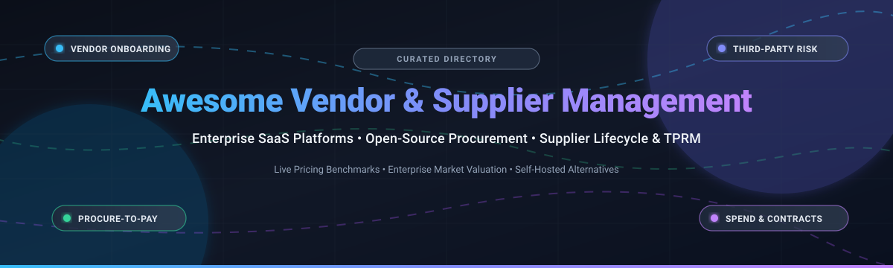

# 🌐 Awesome Vendor & Supplier Management 🚀

> 🌟 **A definitive, curated directory of the best Vendor Management Systems (VMS), Supplier Relationship Management (SRM) platforms, and e-Procurement solutions** — covering industry-leading enterprise SaaS tools, real-world pricing models, free tiers, market valuations, and self-hosted open-source alternatives. 🌟

---

## 📌 Table of Contents 📑

- [📈 Sector Overview & Market Dynamics](#-sector-overview--market-dynamics)
- [🏢 SaaS & Hosted Commercial Platforms](#-saas--hosted-commercial-platforms)
  - [📊 SaaS Pricing, Free Tier & Market Valuation Comparison](#-saas-pricing-free-tier--market-valuation-comparison)
  - [🔍 Detailed SaaS Platform Profiles](#-detailed-saas-platform-profiles)
- [💻 Open-Source & Self-Hosted Software](#-open-source--self-hosted-software)
  - [⭐ Open-Source GitHub_Stars & Capabilities Matrix](#-open-source-stars--capabilities-matrix)
  - [📦 Detailed Open-Source Project Profiles](#-detailed-open-source-project-profiles)
- [⚖️ Comprehensive Feature Comparison](#-comprehensive-feature-comparison)
- [💖 Support & Community](#-support--community)
- [⭐ Star History](#-star-history)
- [🤝 Contributing Guidelines](#-contributing-guidelines)
- [📄 License & Usage](#-license--usage)

---

## 📈 Sector Overview & Market Dynamics 🌐

The global **Vendor Management Software (VMS)** and **Supplier Relationship Management (SRM)** market is valued at approximately **$11B to $20B**, expanding at a robust double-digit compound annual growth rate (CAGR of **10%–15%**) driven by supply-chain digitalization, stricter third-party regulatory oversight (e.g., DORA, NIS2, and ESG compliance), and AI-driven procurement automation. 

The industry exhibits a **moderately fragmented** market structure characterized by a distinct two-tier competitive landscape:
1. **Tier-1 Enterprise Mega-Suites (Concentrated Core):** Legacy ERP and spend-management behemoths (e.g., SAP SE, Coupa) anchor mission-critical procurement for Fortune 500 enterprises with deep ERP back-office integration.
2. **Tier-2 Agile Best-of-Breed Specialists (Fragmented Innovation):** Dynamic pure-play software vendors compete fiercely across specialized niches such as automated AP invoicing (Tipalti), mid-market intake-to-procure (Precoro), vendor contract lifecycles (Gatekeeper), and SaaS renewal intelligence (Vertice/Vendr).

---

## 🏢 SaaS & Hosted Commercial Platforms ☁️

Cloud-native, enterprise-grade Vendor Management and Procurement platforms. Below is the breakdown ranked by **Market Valuation / Enterprise Scale** (descending), complete with verified starting subscription pricing and specific free trial terms.

### 📊 SaaS Pricing, Free Tier & Market Valuation Comparison

| Platform 🏷️ | Primary Focus 🎯 | Market Scale / Valuation 💰 | Starting Tier Pricing 💳 | Free Tier / Trial Terms ⏱️ |
|:---|:---|:---|:---|:---|
| **[SAP Ariba](https://www.ariba.com/)** 🇩🇪 | Enterprise Source-to-Pay & Supplier Governance | **$250B+ Market Cap** *(SAP SE Public; ~€32B annual rev)* | **$2,420 / month** *(Core standalone modules, billed annually)* | **Free standard supplier account** *(Document limits apply; fees kick in after 5 POs/invoices and $50k spend); 0-day buyer trial (guided demos only)* |
| **[Tipalti](https://tipalti.com/)** 🇺🇸 | Global Supplier Onboarding & Mass AP Automation | **$8.3B Valuation** *(Dec 2021 funding round; ~$182M ARR)* | **$99 / month** *(Base platform fee + variable FX & payout transaction fees)* | **0-day free trial** *(Live sandbox demo provided only upon scheduled sales consultation; no unassisted free trial)* |
| **[Coupa](https://www.coupa.com/)** 🇺🇸 | Enterprise Business Spend & Supplier Lifecycle | **$8.0B Acquisition** *(Acquired by Thoma Bravo; ~$818M rev)* | **$1,667 / month** *($20,000 / year base mid-market procurement module)* | **Free supplier portal** *(Free basic tier for receiving orders & up to 10 free AI invoice uploads); 30-day free trial for Advanced Supplier tier; 0-day trial for enterprise buyers* |
| **[Jaggaer](https://www.jaggaer.com/)** 🇺🇸 | Autonomous Procurement & Direct Material Sourcing | **$3.0B Acquisition** *(Acquired by Vista Equity Partners in 2024; ~$300M ARR)* | **$510 / month** *(~£4,600 / year for entry G-Cloud module tier, 5–10 users)* | **0-day free trial** *(Enterprise procurement platform requires guided discovery and custom POC; no public self-service trial)* |
| **[Ivalua](https://www.ivalua.com/)** 🇫🇷 | Unified Source-to-Pay & Supplier Risk Management | **$1.1B Valuation** *(Private equity unicorn; ~$160M–$200M ARR)* | **$12,500 / month** *($150,000 / year base enterprise deployment package)* | **0-day free trial** *(Strictly enterprise quote-based; no self-serve free plan or automated trial)* |
| **[Vendr](https://www.vendr.com/)** *(Vertice)* 🇺🇸 | SaaS Procurement & Automated Renewal Intelligence | **$1.0B Valuation** *(Series B valuation; acquired by Vertice 2026; ~$95M ARR)* | **$3,333 / month** *($40,000 / year Starter tier for software under management)* | **Free community tool access** *(Free basic software spend benchmarks & contract upload audits); 0-day trial for guided negotiation services* |
| **[Gatekeeper](https://www.gatekeeperhq.com/)** 🇬🇧 | Vendor Lifecycle & Integrated Contract Management | **$150M+ Est. Valuation** *(Strategic growth investment from Vista Equity; ~$20M ARR)* | **$1,245 / month** *(Essentials Plan for core vendor & contract tracking, billed annually)* | **14-day free trial** *(Configurable sandbox environment available through marketplace/demo activation)* |
| **[Precoro](https://precoro.com/)** 🇺🇸 | Mid-Market Procure-to-Pay & Purchasing Automation | **$50M+ Est. Valuation** *(Profitable bootstrapped scale-up; ~$10M–$15M ARR)* | **$499 / month** *(Core Plan for up to 20 active users, billed annually)* | **14-day free trial** *(Full-featured access to PO creation, vendor catalogs, and approval workflows without credit card)* |

---

### 🔍 Detailed SaaS Platform Profiles 📝

#### 💎 SAP Ariba Supplier Management
- **Category:** Global Enterprise Supplier Lifecycle & Governance
- **Target Audience:** Fortune 500 corporations with multi-ERP infrastructures and global supplier networks.
- **Key Capabilities:** Deep supplier qualification questionnaires, dynamic performance scoring, ESG risk assessment, integrated sourcing events, and automated electronic invoicing via the SAP Business Network.

#### 💸 Tipalti Supplier Portal
- **Category:** Supplier Onboarding, International Tax & Cross-Border Payments
- **Target Audience:** High-growth technology firms, digital marketplaces, and cross-border operations managing thousands of global payees.
- **Key Capabilities:** Self-service payee onboarding, tax form collection (W-9, W-8BEN), 26 000+ automated banking validation rules, automated 2FA fraud detection, and instant multi-currency payouts in 196 countries.

#### 📊 Coupa Supplier Management
- **Category:** Enterprise Business Spend Management (BSM) & Supplier Collaboration
- **Target Audience:** Mid-market to multi-national enterprises seeking centralized spend controls.
- **Key Capabilities:** Unified supplier profile repository, automated supplier performance scoring, community intelligence risk indicators, multi-tier PO dispatch, and early payment discounts.

#### 🏭 Jaggaer (JAGGAER ONE)
- **Category:** Direct & Indirect Procurement & Supplier Value Management
- **Target Audience:** Manufacturing, automotive, healthcare, and higher-education procurement leaders.
- **Key Capabilities:** Advanced BOM (Bill of Materials) sourcing, supplier quality management, contract lifecycle automation, and predictive supplier risk monitoring.

#### ⚙️ Ivalua
- **Category:** Highly Configurable Source-to-Pay (S2P) Suite
- **Target Audience:** Organizations with intricate procurement processes demanding tailorable data models without custom code branching.
- **Key Capabilities:** Single-table architecture, comprehensive 360-degree supplier 4-pillar risk view (cyber, financial, legal, operational), environmental compliance, and catalog management.

#### 🤖 Vendr (by Vertice)
- **Category:** Software & SaaS Vendor Procurement Negotiation
- **Target Audience:** CFOs, CIOs, and IT procurement teams spending $1M+ annually on B2B SaaS.
- **Key Capabilities:** Software contract centralization, real-time pricing benchmark intelligence, automated intake approval workflows, and contract renewal execution.

#### 📑 Gatekeeper
- **Category:** Unified Vendor & Contract Lifecycle Management (VCLM)
- **Target Audience:** Mid-size to enterprise legal and procurement departments prioritizing compliance.
- **Key Capabilities:** Automated vendor onboarding Kanban boards, third-party risk assessments, AI contract extraction, automated renewal notices, and native e-signatures.

#### 🎯 Precoro
- **Category:** Streamlined Mid-Market Procurement & PO Automation
- **Target Audience:** Fast-growing companies replacing messy email approvals and Excel purchase tracking.
- **Key Capabilities:** 2-way and 3-way PO matching, real-time department budget tracking, custom multi-tier approval chains, custom vendor catalogs, and automated NetSuite/QuickBooks/Xero syncing.

---

## 💻 Open-Source & Self-Hosted Software 🔓

Self-hosted, transparent, and developer-friendly Vendor Management Systems, Supplier MCP backbones, and Procurement automation tools. Ranked below in descending order by **GitHub Stars_Count**.

### ⭐ Open-Source GitHub_Stars & Capabilities Matrix

| Repository & Project 📦 | GitHub_Stars (Social Badge) ⭐ | Stack / Framework 🛠️ | License 📜 | Self-Hosted 🏠 | Supplier Portal 🌐 | PO & RFQ 📑 |
|:---|:---:|:---|:---:|:---:|:---:|:---:|
| **[Dolibarr ERP/CRM](https://github.com/Dolibarr/dolibarr)** |  | PHP / MySQL / MariaDB | GPL-3.0 | ✅ | ✅ | ✅ |
| **[ITFlow](https://github.com/itflow-org/itflow)** |  | PHP / MySQL / Bootstrap | GPL-3.0 | ✅ | ✅ | ✅ |
| **[Leihs](https://github.com/leihs/leihs)** |  | Ruby on Rails / Clojure / React | GPL-3.0 | ✅ | ❌ | ✅ |
| **[OpenGRC](https://github.com/LeeMangold/OpenGRC)** |  | Python / Django / React | AGPL-3.0 | ✅ | ✅ | ❌ *(TPRM focus)* |
| **[OpenProcurement API](https://github.com/openprocurement/openprocurement.api)** |  | Python / Pyramid / CouchDB | Apache-2.0 | ✅ | ✅ | ✅ |
| **[Haven GRC](https://github.com/kindlyops/havengrc)** |  | Go / Vue.js / Docker | Apache-2.0 | ✅ | ❌ | ❌ *(TPRM focus)* |
| **[OpenXE](https://github.com/OpenXE-org/OpenXE)** |  | PHP / MySQL / Symfony | AGPL-3.0 | ✅ | ✅ | ✅ |
| **[Procuman Community Edition](https://github.com/procuman/procuman-community-edition)** |  | PHP / EspoCRM / MySQL | GPL-3.0 | ✅ | ❌ *(Pro only)* | ✅ |
| **[Supplier MCP Server](https://github.com/zavora-ai/mcp-supplier)** |  | Rust / Model Context Protocol | Apache-2.0 | ✅ | ❌ *(Agent CLI)* | ✅ *(Gated)* |
| **[VendorBridge AI](https://github.com/vatsalgajera-tech/VendorBridge-AI)** |  | React / Node.js / MongoDB | MIT | ✅ | ✅ | ✅ |
| **[Shillinq](https://github.com/ConductionNL/shillinq)** |  | PHP / Nextcloud App / Vue.js | EUPL-1.2 | ✅ | ⚠️ *(Approval)* | ✅ |
| **[VendSync](https://github.com/RavalMunjal/VendSync)** |  | React / Node.js / MongoDB | MIT | ✅ | ✅ | ✅ |
| **[SevenSquare VMS](https://github.com/SevenSquare-Tech/vendor-management-system)** |  | Laravel (PHP) / Electron / MySQL | MIT | ✅ *(Desktop)* | ❌ | ✅ |

---

### 📦 Detailed Open-Source Project Profiles 🛠️

#### 🌟 [Dolibarr ERP/CRM](https://github.com/Dolibarr/dolibarr)
- **GitHub:** [`Dolibarr/dolibarr`](https://github.com/Dolibarr/dolibarr)
- **Description:** A mature, feature-rich web suite providing comprehensive vendor management, supplier order tracking, price lists, invoice validation, and stock tracking.
- **Key Features:** Full supplier catalog with volume discounts, multi-currency vendor price negotiations, supplier payment scheduling, and PDF purchase generation.
- **Best For:** Small to mid-sized businesses wanting a production-tested, self-hosted vendor & procurement backbone.

#### 🛡️ [ITFlow](https://github.com/itflow-org/itflow)
- **GitHub:** [`itflow-org/itflow`](https://github.com/itflow-org/itflow)
- **Description:** An open-source IT service and vendor management platform designed for Managed Service Providers (MSPs) and internal IT departments.
- **Key Features:** Centralized vendor contact directory, software license renewal tracking, domain & SSL expiry alerts, and contract document storage.
- **Best For:** IT teams and MSPs needing unified tracking of software vendors, subscriptions, and SLAs.

#### 📦 [Leihs](https://github.com/leihs/leihs)
- **GitHub:** [`leihs/leihs`](https://github.com/leihs/leihs)
- **Description:** An established inventory management, procurement, and asset-lending system.
- **Key Features:** Comprehensive asset booking, vendor supplier records, requisition tracking, and audit-proof inventory governance.
- **Best For:** Universities, media labs, and enterprise departments managing asset loans and equipment procurement.

#### 📋 [OpenGRC](https://github.com/LeeMangold/OpenGRC)
- **GitHub:** [`LeeMangold/OpenGRC`](https://github.com/LeeMangold/OpenGRC)
- **Description:** A self-hosted GRC (Governance, Risk, and Compliance) platform built for evaluating and managing third-party vendor risk (TPRM).
- **Key Features:** Vendor risk classification, compliance questionnaires (ISO 27001, SOC 2, NIST), due diligence audit logs, and incident tracking.
- **Best For:** Security and compliance teams conducting rigorous third-party risk assessments.

#### 🏛️ [OpenProcurement API](https://github.com/openprocurement/openprocurement.api)
- **GitHub:** [`openprocurement/openprocurement.api`](https://github.com/openprocurement/openprocurement.api)
- **Description:** The open-source e-Procurement datastore and bidding auction API powering large-scale competitive tender systems (like ProZorro).
- **Key Features:** High-throughput JSON REST API, electronic reverse auctions, public bidding registers, multi-tier document verification, and CouchDB replication.
- **Best For:** Public sector organizations and consortia running transparent procurement tenders.

#### 🔒 [Haven GRC](https://github.com/kindlyops/havengrc)
- **GitHub:** [`kindlyops/havengrc`](https://github.com/kindlyops/havengrc)
- **Description:** Cloud-native compliance and vendor risk management framework designed for engineering and DevSecOps teams.
- **Key Features:** Vendor security reviews, third-party credential management, compliance mapping, and automated audit trails.
- **Best For:** Tech companies looking to bake vendor security governance directly into developer workflows.

#### 💼 [OpenXE](https://github.com/OpenXE-org/OpenXE)
- **GitHub:** [`OpenXE-org/OpenXE`](https://github.com/OpenXE-org/OpenXE)
- **Description:** A modular open-source ERP framework (forked from Xentral) featuring complete purchasing and supplier management modules.
- **Key Features:** Automated purchase suggestions based on stock reorder levels, supplier delivery tracking, and purchase invoice verification.
- **Best For:** Wholesale, e-commerce, and manufacturing teams managing ongoing supplier replenishment.

#### 🧩 [Procuman Community Edition](https://github.com/procuman/procuman-community-edition)
- **GitHub:** [`procuman/procuman-community-edition`](https://github.com/procuman/procuman-community-edition)
- **Description:** A dedicated procurement and supplier management extension built for the EspoCRM platform.
- **Key Features:** Supplier database with contact categorization, multi-currency supplier price books, PO drafting with automated tax formulas, and PDF export.
- **Best For:** EspoCRM users wanting seamless vendor lifecycle management without third-party SaaS tools.

#### 🤖 [Supplier MCP Server](https://github.com/zavora-ai/mcp-supplier)
- **GitHub:** [`zavora-ai/mcp-supplier`](https://github.com/zavora-ai/mcp-supplier)
- **Description:** A Supplier Relationship Management (SRM) backend engineered as a Model Context Protocol (MCP) server for autonomous AI agents.
- **Key Features:** 34 specialized procurement tools spanning qualification, RFQ quote comparison, quality audits (SCARs), supplier scorecards, and cryptographic audit logs.
- **Best For:** AI engineers building autonomous procurement agents with strict governance guardrails.

#### ⚡ [VendorBridge AI](https://github.com/vatsalgajera-tech/VendorBridge-AI)
- **GitHub:** [`vatsalgajera-tech/VendorBridge-AI`](https://github.com/vatsalgajera-tech/VendorBridge-AI)
- **Description:** An AI-powered full-stack procurement and vendor ERP application built with modern React and Node.js.
- **Key Features:** Automated vendor risk scoring, intelligent quotation parsing and comparison, role-based dashboards, and automated PO creation.
- **Best For:** Hackathon teams and developers seeking a clean AI-driven procurement reference architecture.

#### ☁️ [Shillinq](https://github.com/ConductionNL/shillinq)
- **GitHub:** [`ConductionNL/shillinq`](https://github.com/ConductionNL/shillinq)
- **Description:** An enterprise business administration and procurement suite built directly as a self-hosted Nextcloud app.
- **Key Features:** Purchase requisitions, multi-level approval workflows, supplier compliance certificate storage, and contract repository search.
- **Best For:** Self-hosted organizations and governments running Nextcloud infrastructure.

#### 🔄 [VendSync](https://github.com/RavalMunjal/VendSync)
- **GitHub:** [`RavalMunjal/VendSync`](https://github.com/RavalMunjal/VendSync)
- **Description:** A full-stack web ERP handling the end-to-end procurement cycle from RFQ generation to invoice settlement.
- **Key Features:** Dedicated vendor portal for submitting competitive quotes, approval workflows with audit notes, and real-time analytics.
- **Best For:** Teams wanting a lightweight React/Node.js base for custom vendor portal development.

#### 🖥️ [SevenSquare Vendor Management System](https://github.com/SevenSquare-Tech/vendor-management-system)
- **GitHub:** [`SevenSquare-Tech/vendor-management-system`](https://github.com/SevenSquare-Tech/vendor-management-system)
- **Description:** A desktop-packaged Vendor Management System built with Laravel and Electron.
- **Key Features:** Local desktop database of supplier contracts, renewal alert popups, PO tracking, and offline performance reporting.
- **Best For:** Small business operations requiring a local, offline-capable desktop application.

---

## ⚖️ Comprehensive Feature Comparison 📋

| Solution 🛠️ | Deployment Model 🚀 | License Type 📜 | Dedicated Supplier Portal 🌐 | Purchase Order (PO) 📑 | Contract Tracking 📂 | AI / Automation 🤖 |
|:---|:---|:---|:---:|:---:|:---:|:---:|
| **SAP Ariba** | Cloud SaaS | Commercial | ✅ | ✅ | ✅ | ✅ *(Enterprise AI)* |
| **Coupa** | Cloud SaaS | Commercial | ✅ | ✅ | ✅ | ✅ *(Spend AI)* |
| **Tipalti** | Cloud SaaS | Commercial | ✅ | ⚠️ *(Payments)* | ✅ | ✅ *(OCR / Tax)* |
| **Jaggaer** | Cloud SaaS | Commercial | ✅ | ✅ | ✅ | ✅ *(Sourcing AI)* |
| **Ivalua** | Cloud SaaS | Commercial | ✅ | ✅ | ✅ | ✅ *(Risk AI)* |
| **Vendr** | Cloud SaaS | Commercial | ✅ | ⚠️ *(Intake)* | ✅ | ✅ *(Price Data)* |
| **Gatekeeper** | Cloud SaaS | Commercial | ✅ | ⚠️ *(Contracts)*| ✅ | ✅ *(Contract AI)* |
| **Precoro** | Cloud SaaS | Commercial | ✅ | ✅ | ✅ | ✅ *(3-Way Match)* |
| **Dolibarr** | Self-Hosted | Open Source (GPL) | ✅ | ✅ | ✅ | ⚠️ *(Plugins)* |
| **ITFlow** | Self-Hosted | Open Source (GPL) | ✅ | ✅ | ✅ | ❌ |
| **Leihs** | Self-Hosted | Open Source (GPL) | ❌ | ✅ | ❌ | ❌ |
| **OpenGRC** | Self-Hosted | Open Source (AGPL)| ✅ | ❌ | ✅ | ❌ |
| **OpenProcurement**| Self-Hosted | Open Source (Apache)| ✅ | ✅ | ✅ | ❌ |
| **Supplier MCP** | Self-Hosted | Open Source (Apache)| ❌ | ✅ | ⚠️ | ✅ *(Agent Native)*|
| **VendorBridge AI**| Self-Hosted | Open Source (MIT) | ✅ | ✅ | ⚠️ | ✅ *(Gemini/LLM)* |
| **Shillinq** | Self-Hosted | Open Source (EUPL)| ⚠️ | ✅ | ✅ | ❌ |

---

## 💖 Support & Community ☕

Thank you for visiting and using this curated directory! If you find this resource helpful for your work, team, or projects, please consider supporting the project:

- ⭐ **Star this repository** to help others discover it!
- 🍴 **Fork and contribute** your favorite vendor and supplier management tools.
- 📢 **Share this list** with colleagues, procurement teams, and fellow developers on social media or in your developer communities.
- ☕ **Buy a coffee / Sponsor:** Support ongoing maintenance, research, and open-source updates via the [GitHub Sponsors Dashboard](https://github.com/sponsors/ishandutta2007).

---

## ⭐ Star History

---

## 🤝 Contributing Guidelines 💡

Contributions are warmly welcome! Whether you are an open-source author or an enterprise procurement specialist, help us make this directory the most comprehensive resource on the web.

To propose a new tool:
1. Fork this repository 🍴
2. Add your tool to the corresponding section with verified pricing or Stars_Badges 📝
3. Verify all markdown links and formatting ✨
4. Submit a Pull Request with a clear summary of why the tool is valuable 🚀

---

## 📄 License & Usage 📜

To the extent possible under law, this repository and all curated compilations are dedicated to the public domain under **CC0 1.0 Universal**. Individual software projects, logos, and platforms remain property of their respective owners.

  Built with ❤️ for procurement engineers, supply chain managers, and software developers worldwide.

